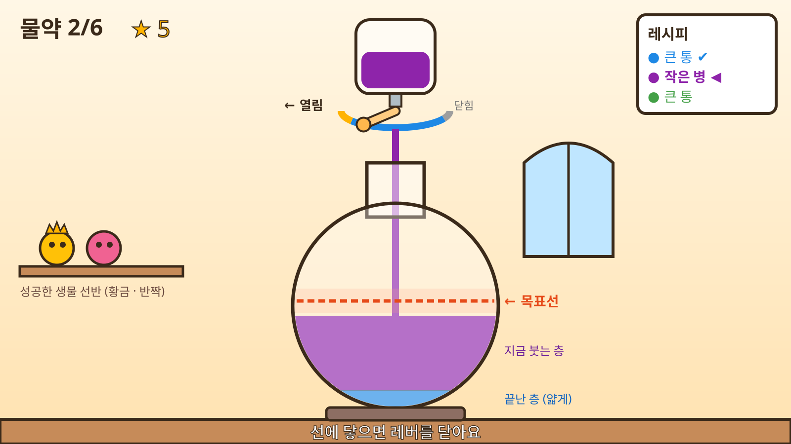
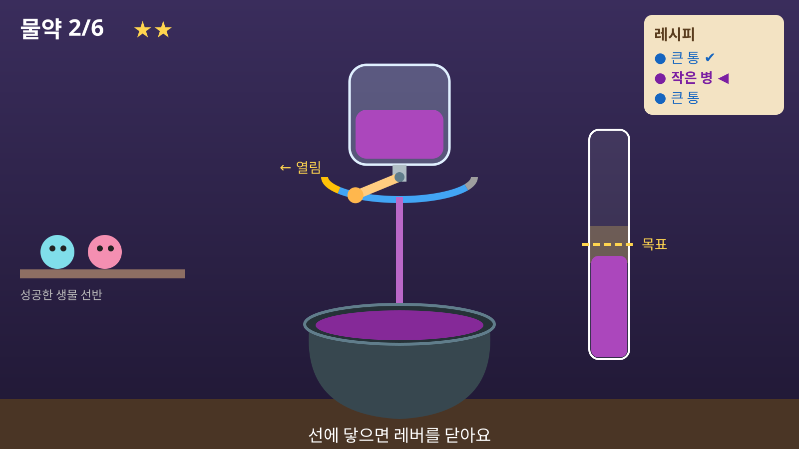
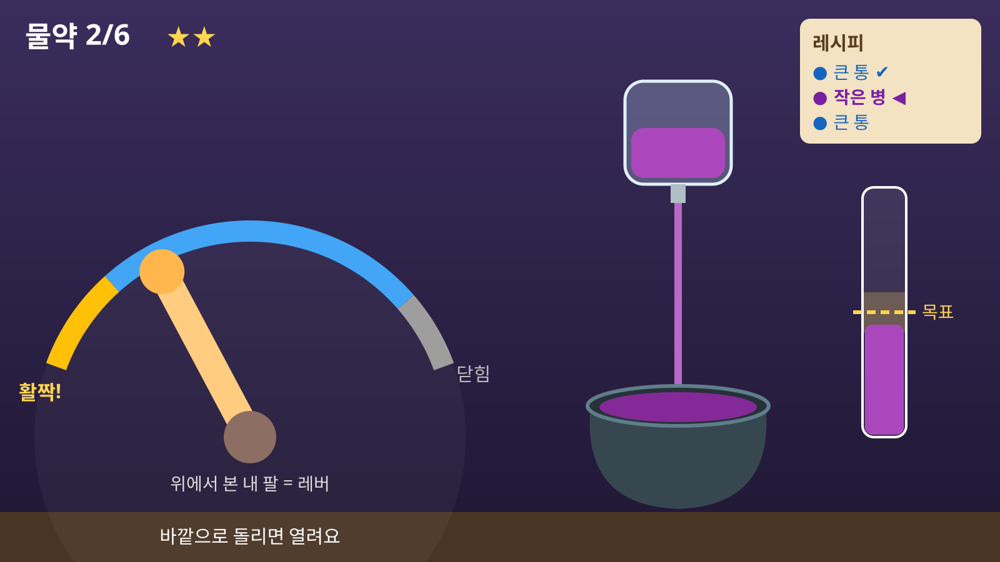
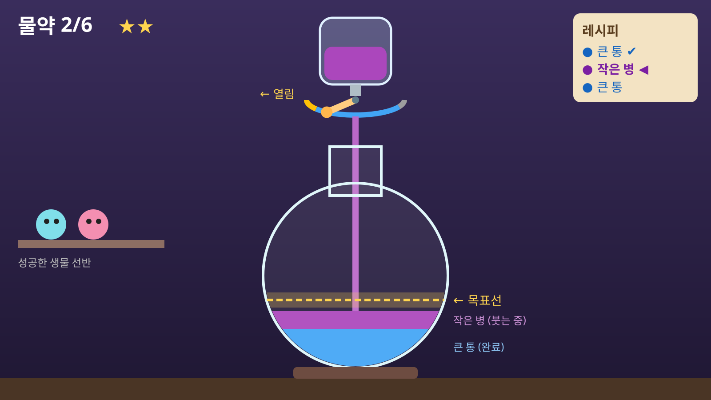
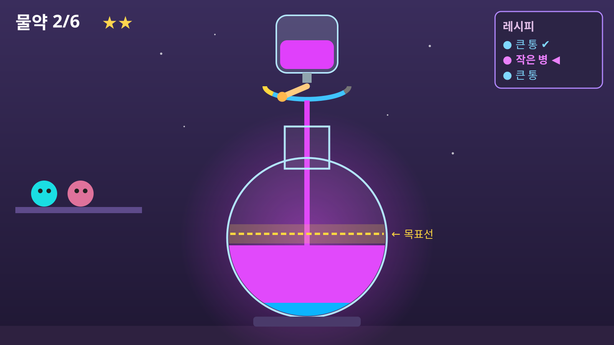
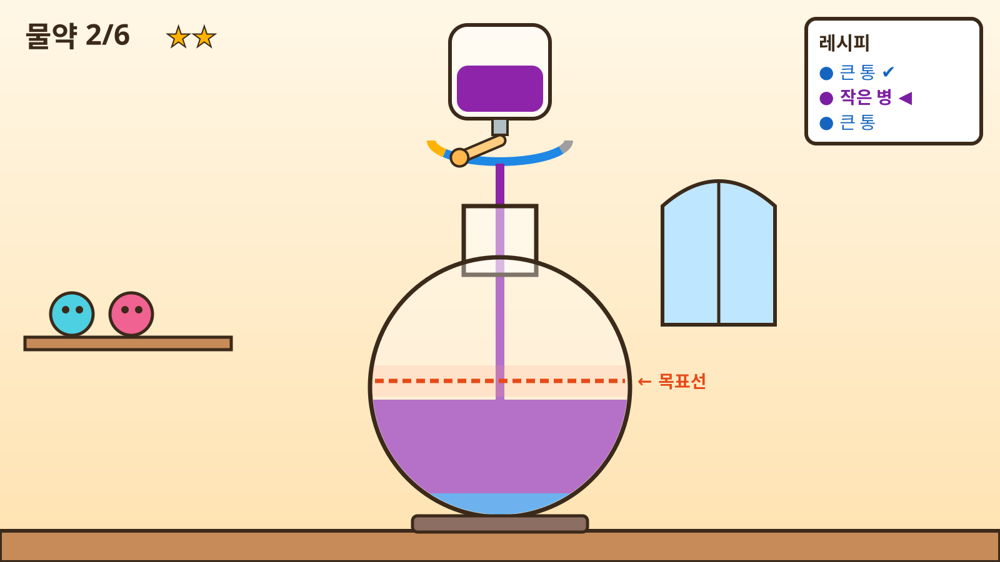
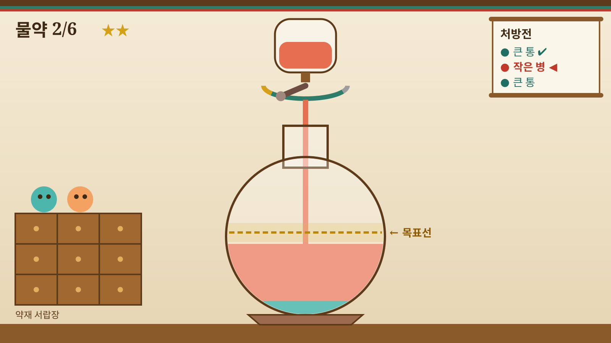

# [E3] 물약 제조 게임 (Potion Maker) 제작 가이드
**최초 작성**: 2026-06-10  
**최종 수정**: 2026-09-21 (v2 — 기획 전면 재설계)  
**파일**: `lib/games/games/potion_maker_logic.dart`(규칙), `lib/games/games/potion_maker_game.dart`(화면), `test/potion_maker_logic_test.dart`(테스트)  
**수정 금지**: `game_base.dart`, `game_motor_controller.dart` (예외 요청은 부록 A 참고)

> v1 문서(2026-06-10)와 기존 `potion_maker_game.dart`(966줄)는 폐기합니다. 이전 내용은 git 커밋 `948dac5`에서 볼 수 있습니다.

---

## 현재 상태 (2026-09-21 기준)

| 항목 | 상태 |
|------|------|
| 기획 재설계 (관절·메카닉·등급 보상·실패 연출) | ✅ 완료 |
| 화면 디자인 (배치: 유리 플라스크 층 쌓기 / 분위기: 밝은 동화 실험실) | ✅ 완료 |
| 규칙 파일 `potion_maker_logic.dart` + 단위 테스트 | ❌ 미착수 |
| 화면 파일 `potion_maker_game.dart` 재작성 (Canvas 도형) | ❌ 미착수 |
| 결과 연출 (등급별 성공 생물 / 엉뚱한 결과물) | ❌ 미착수 |
| `game_hub` 관절 변경 (`lElbow` → `lShoulderRo`) · 설명 문구 | ❌ 미착수 |
| **로봇 팔꿈치 90° 고정 (펌웨어 기능)** | ⏳ 펌웨어 담당자에게 요청 예정 (부록 A) |
| 스프라이트 · BGM · 효과음 | ⏸ 코어 완성 후 |

---

## 0. v1 → v2 변경 요약

| 항목 | v1 (폐기) | v2 (현재) |
|------|-----------|-----------|
| 관절 | 어깨 굽힘 + 팔꿈치 + 어깨 돌림 (여러 관절) | **어깨 가쪽/안쪽돌림(`lShoulderRo`) 하나** |
| 팔꿈치 | 환자가 스스로 90° 유지 | **로봇이 90°로 옮겨 고정** |
| 조작 대상 | 장갑 커서로 병 잡기 → 병 기울이기 | **재료통 꼭지의 레버 열기** |
| 각도의 의미 | 병 기울기 | **레버 열림 = 흐르는 속도** (양은 시간에 따라 쌓임) |
| 훈련 요소 | 자세 유지 + 붓기 | **큰 통: 끝까지 반복 / 작은 병: 목표선에서 멈추기** |
| 크게 열기 보상 | 없음 | **등급 보상**: 레버를 크게 열수록 성공 물약 등급 ↑ (★1~3) |
| 화면 | 가마솥 + 별도 룬 게이지 | **유리 플라스크에 재료가 색깔 층으로 쌓임** (목표선이 플라스크 위에 바로 표시) |
| 분위기 | 밤의 마법 실험실 (어두운 배경, 네온) | **밝은 동화 실험실** (크림색 배경, 굵은 외곽선) |
| 종료 조건 | 목표 개수 | 목표 물약 개수 (최대 시간 상한 별도) |
| 실패 | 목숨 감소, 가마솥 흔들림, 폭발, 독성 연기 | **엉뚱한 결과물** (부푼 생물 / 콩알 생물), 목숨 없음 |
| 코드 구조 | 한 파일 | **규칙(순수 Dart) + 화면 분리**, 규칙은 단위 테스트 |

**유지하는 것**: 연금술 실험실 테마, 레시피 두루마리, 완성 생물 선반, 액체 방울·성공 폭죽 파티클.

---

## 1. 게임 한눈에 보기

**한 줄 요약**: 어깨를 바깥으로 돌려 재료통 꼭지의 레버를 열고, 레시피대로 재료를 유리 플라스크에 층층이 부어 물약을 만든다.

### 1-1. 훈련 목표

| 목표 | 게임 요소 |
|------|-----------|
| 가동범위 반복 | 🔵 **큰 통**: 레버를 끝까지 열어야만 흐름 / **등급 보상**: 작은 병도 크게 열수록 높은 등급 |
| 등급화된 운동 조절 | 🟣 **작은 병**: 목표선에 가까워질 때 레버를 서서히 닫아 정확히 멈추기 |
| 공동운동 분리 | 로봇이 팔꿈치를 90°로 고정한 상태에서 어깨 돌림만 수행 |

작은 병에서 가장 높은 등급을 받으려면 **레버를 크게 열어 빠르게 붓다가, 목표선 직전에 닫아야** 한다. 가동범위와 조절을 한 동작에서 함께 훈련한다.

### 1-2. 금고털이[S4]와의 차이

같은 관절(`lShoulderRo`)을 쓰지만 훈련하는 능력이 다르다.

| | 금고털이 | 물약 제조 |
|---|---|---|
| 각도가 뜻하는 것 | 다이얼 **위치** | 레버 열림 = **흐르는 속도** |
| 핵심 능력 | 목표 각도에 맞추고 버티기 | 속도를 조절하고 **제때 멈추기** (예측 조절) |

### 1-3. 플레이 흐름

```
시작 → (로봇이 팔꿈치 90° 고정) → 3·2·1 카운트다운
  ↓
물약 1개 = 재료 3~5개
  재료마다:  레버 닫힌 상태에서 시작
             → 바깥으로 돌려 레버 열기 → 재료가 플라스크로 흘러 새 층이 쌓임
             → 안쪽으로 돌려 레버 닫기 → 판정
  ↓
물약 완성 → 층을 실제 비율로 펼쳐 보여 줌
         → 성공: 등급별 생물(일반·반짝·황금)이 선반에 전시
         → 실패: 엉뚱한 결과물(잠깐 보여 주고 사라짐)
  ↓
목표 물약 개수 달성 또는 최대 시간(8분) → 결과 화면
```

---

## 2. 입력과 로봇

### 2-1. 관절 입력

- **관절**: `lShoulderRo` (왼쪽 어깨 안쪽/가쪽돌림), 팔꿈치 90°.
- **정규화**: `config.normalizer.normalize(raw)` → `p` (0~1).
  - `p = 0`: 캘리브레이션 범위의 **안쪽돌림 끝** = 레버 닫힘
  - `p = 1`: 캘리브레이션 범위의 **가쪽돌림 끝** = 레버 최대 열림
- **레버 열림**: `o = clamp(p / config.romRatio, 0, 1)`
  - Brunnstrom 단계가 낮을수록 적은 회전으로 레버가 끝까지 열린다 (`romRatio` 0.4~1.0, `GameConfig` 기존 값).
- ⚠️ **실기기 확인 필수**: 센서 부호 때문에 가쪽돌림이 `p = 0` 쪽으로 나오면 `p = 1 - p`로 뒤집는다. 금고털이 시뮬 슬라이더는 `0 = 안쪽, 1 = 바깥`으로 표시돼 있다.

### 2-2. 팔꿈치 90° 로봇 고정

**원칙**: 팔꿈치는 환자가 버티는 게 아니라 **로봇이 90°로 옮겨 고정**한다. 환자는 어깨 돌림에만 집중한다.

**필요한 순서**

1. `PART:lElbow` → 팔꿈치를 **천천히** 90°로 이동 → 위치 고정
2. `PART:lShoulderRo` → 팔꿈치는 고정한 채 어깨 돌림 각도를 받아 게임 진행
3. 게임 종료·정지·비상정지 → 팔꿈치 고정 해제

**현재는 불가능하다.**
- 현재 프로토콜은 `PART:`로 **관절 하나만** 선택한다. 각도 스트림도, 모터 명령도 그 관절 하나에만 적용된다.
- 가장 가까운 `isometric,각도,시간`은 유지 시간이 최대 10초로 제한된다 (`GameMotorController.maxIsometricHoldTime`).
- `PART`를 어깨로 바꾼 뒤 팔꿈치 모터가 계속 버티는지는 펌웨어 동작이다.

**펌웨어가 준비되기 전 운영 방식**
- **개발**: 시뮬레이터 모드(`_isSim`, BT 미연결 시 자동)로 먼저 완성한다.
- **실기기 테스트**: 화면 상단에 "팔꿈치를 90°로 굽힌 채 유지해 주세요" 안내를 띄우고, 치료사가 팔꿈치 위치를 잡아 준다 (금고털이와 같은 방식).
- **펌웨어 준비 후**: 부록 A의 명령을 게임 시작/종료 흐름에 연결한다.

---

## 3. 게임 규칙

모든 수치는 **초기값**이며, 실기기 QA에서 `potion_maker_logic.dart` 한 곳만 고쳐서 조정한다.

### 3-1. 레버 구간

| 레버 열림 `o` | 의미 |
|---------------|------|
| 0 ~ 0.15 | 닫힘 — 흐르지 않음 |
| 0.15 ~ 1.0 | 작은 병: 열린 만큼 흐름 |
| 0.80 ~ 1.0 | 큰 통: 이 구간에서만 흐름 |

**열림/닫힘 상태 판정** (반복 횟수 세기·확정 판정에 사용)은 경계 떨림을 막기 위해 히스테리시스를 둔다.
- 열림으로 바뀜: `o ≥ 0.18`
- 닫힘으로 바뀜: `o < 0.12`
- 그 사이에서는 직전 상태를 유지한다.

### 3-2. 🔵 큰 통 (가동범위 훈련)

- 꼭지가 뻑뻑한 통이다. `o ≥ 0.80`일 때만 일정한 속도로 흐른다.
- 흐른 시간의 합이 `bigTankPourTime`(4-2)에 도달하면 통이 비워진다. 중간에 닫았다가 다시 열어도 된다(그만큼 반복 횟수가 늘어난다).
- **실패 없음**. 통이 비워진 뒤 레버를 닫으면 완료(`emptied`).

### 3-3. 🟣 작은 병 (조절 훈련)

- 플라스크의 현재 층에 **목표선**이 있다 (층 높이 0~1 기준).
- 흐르는 속도: `rate = smallFlowRate × (o − 0.15) / 0.85` (`o < 0.15`면 0)
- **판정**
  - **과다(`over`)**: 양이 `목표 + 허용 오차`를 넘는 순간 즉시 확정한다. 흐름이 멈추고 넘치는 연출을 보여 준다.
  - **확정 대기**: 양이 0보다 큰 상태에서 레버가 닫히면 **1.0초** 확정 대기를 시작한다 (목표선 옆에 채워지는 원으로 표시).
    - 대기 중 다시 열면 확정을 취소하고 이어서 붓는다. **모자라면 더 부을 수 있지만, 넘치면 되돌릴 수 없다.**
    - 1.0초가 지나면 판정한다: `|양 − 목표| ≤ 허용 오차` → **정확(`exact`)**, 목표보다 적음 → **과소(`under`)**.

### 3-4. 반복과 재료 진행

- **1회 반복** = 레버 열림 → 닫힘 (3-1의 상태 판정 기준). 반복 횟수는 이벤트로 기록한다.
- **새 재료는 레버가 닫힌 상태에서 시작**한다. 과다나 큰 통 비움 뒤에도 레버를 닫아야 다음 재료가 나온다.
- 재료가 끝나면 다음 재료가 나오기까지 **1.0초** 전환 연출이 있고, 이때 입력은 무시한다.
- 재료 순서: **첫 재료는 항상 큰 통**(워밍업), 나머지는 무작위로 섞는다.
- 재료마다 **최대 열림**(`maxOpening`, 그 재료를 붓는 동안 `o`의 최댓값)을 기록한다. 등급 계산에 쓴다.

### 3-5. 물약 결과와 등급

재료를 모두 부으면 물약 결과를 정한다.

| 조건 | 결과 |
|------|------|
| 작은 병이 모두 정확 (또는 작은 병 없음) | ✨ **성공** — 등급에 따라 생물이 태어나 선반에 전시 |
| 오차가 가장 큰 작은 병이 과다 | 🎈 **부푼 생물** (엉뚱한 결과물) |
| 오차가 가장 큰 작은 병이 과소 | 🫘 **콩알 생물** (엉뚱한 결과물) |

**성공 등급** — 물약에 들어간 **모든 재료의 최대 열림 평균**으로 정한다.

| 평균 최대 열림 | 등급 | 별 |
|----------------|------|----|
| 0.85 이상 | 🥇 **황금** | ★★★ |
| 0.60 이상 | ✨ **반짝** | ★★ |
| 0.60 미만 | 🙂 **일반** | ★ |

- 큰 통은 0.80 이상 열어야 흐르므로 항상 평균을 끌어올린다. 큰 통만 있는 물약(Brunnstrom 2단계)도 0.85 이상 열면 황금이 된다.
- 엉뚱한 결과물도 **완성한 물약 개수에는 포함**한다. 목표는 운동량이므로, 어려워하는 환자도 판이 끝없이 길어지지 않게 한다.
- 대신 **점수·별·선반 전시는 성공에만** 준다. 일부러 실패하는 것을 막기 위해서다.

### 3-6. 판 종료

- 완성한 물약 수가 목표 개수(4-1)에 도달하면 종료한다.
- **최대 시간 8분**이 지나면 그 시점에 종료한다 (피로 방지).
- 정지 버튼, 비상정지 버튼으로 언제든 종료할 수 있다.
- 허브의 "게임 시간"(30~120초) 설정은 이 게임에 **적용하지 않는다**. 목표 개수로 끝나는 게임이기 때문이다.

### 3-7. 점수와 기록

| 이벤트 | 점수 |
|--------|------|
| 큰 통 비움 | +50 |
| 작은 병 정확 | +100 + 보너스 `round(50 × (1 − 오차 / 허용 오차))` (오차 = 양과 목표의 차이의 절댓값) |
| 작은 병 과다 / 과소 | 0 |
| 물약 성공 | 일반 +100 (★1) / 반짝 +150 (★2) / 황금 +200 (★3) |

- `GameResult.hits` = 큰 통 비움 + 작은 병 정확, `misses` = 과다 + 과소
- `accuracy` = `hits / (hits + misses)`
- `maxPossibleScore` = 레시피 전체를 보너스 최대로 정확히 붓고 모든 물약이 황금일 때의 점수
- `angleHistory`: 입력마다 `AngleRecord`를 남긴다 (`targetPosition`은 비움). `event` 값:

| event | 시점 |
|-------|------|
| `lever_open` / `lever_close` | 레버 열림/닫힘 상태가 바뀔 때 (반복 횟수 계산용) |
| `tank_empty` | 큰 통 비움 |
| `exact` / `over` / `under` | 작은 병 판정 |
| `potion_normal` / `potion_shiny` / `potion_gold` | 성공 물약 (등급별) |
| `potion_swollen` / `potion_tiny` | 엉뚱한 결과물 |

---

## 4. 난이도 파라미터 (초기값)

두 축으로 조정한다. **difficultyLevel(1~5)**은 과제의 양과 정밀도를 정하고, **Brunnstrom 단계**는 환자의 능력에 맞춘다.

### 4-1. difficultyLevel

| Level | 목표 물약 수 | 물약당 재료 수 | 기본 허용 오차 | 목표선 후보 | 예상 반복 횟수 |
|-------|-------------|---------------|---------------|------------|---------------|
| 1 | 4 | 3 | ±0.12 | 0.5 | 12회 이상 |
| 2 | 5 | 3 | ±0.10 | 0.5 | 15회 이상 |
| 3 | 6 | 4 | ±0.08 | 0.3 / 0.5 / 0.7 | 24회 이상 |
| 4 | 7 | 4 | ±0.06 | 0.3 / 0.5 / 0.7 | 28회 이상 |
| 5 | 8 | 5 | ±0.05 | 0.25 ~ 0.75 (0.05 간격 무작위) | 40회 이상 |

(허용 오차와 목표선은 층 높이 0~1 기준. 반복 횟수는 재료당 1회로 센 최소값이다.)

### 4-2. Brunnstrom 단계

| 단계 | 레버 끝까지 필요한 회전 (`romRatio`) | 작은 병 흐름 `smallFlowRate` (층/초) | 작은 병 비율 | 허용 오차 배율 | `bigTankPourTime` |
|------|------|------|------|------|------|
| 2 | 40% | 0.10 | 0 (큰 통만) | ×1.6 | 1.5초 |
| 3 | 60% | 0.15 | 25% | ×1.4 | 2.0초 |
| 4 | 80% | 0.20 | 40% | ×1.2 | 2.5초 |
| 5 | 100% | 0.25 | 50% | ×1.0 | 3.0초 |
| 6 | 100% | 0.30 | 60% | ×0.8 | 3.0초 |

- `romRatio`는 `GameConfig.romRatio` 기존 값을 쓴다. `smallFlowRate = 0.25 × config.speedMultiplier`.
- 물약당 작은 병 수 = `round(재료 수 × 작은 병 비율)`
- 최종 허용 오차 = 기본 허용 오차 × 허용 오차 배율, **0.03 ~ 0.20으로 제한**
- 목표선 + 허용 오차가 0.95를 넘지 않게 한다.
- 등급 기준(황금 0.85, 반짝 0.60)은 단계와 관계없이 같다. 레버 열림 `o`가 이미 `romRatio`로 환자별 가동범위에 맞춰져 있기 때문이다.

### 4-3. 인지 레벨

`CognitiveLevel` 기존 값을 그대로 쓴다 (오브젝트 크기, 파티클 수, HUD 표시 범위). 허용 오차에는 적용하지 않는다.

---

## 5. 화면 디자인

**배치**: 유리 플라스크 층 쌓기. **분위기**: 밝은 동화 실험실. (2026-09-21 목업 비교로 확정, 검토한 다른 안은 부록 B)  
1차는 트로트처럼 **도형으로 직접 그리고**, 스프라이트는 코어 완성 후 교체한다.



*작은 병을 붓는 중: 레버 70% 열림, 목표선은 지금 층의 절반. 좌표는 1600×900 기준이며 구현 시 화면 크기에 맞춰 비율로 늘린다.*

```
┌────────────────────────────────────────────────────────────┐
│ 물약 2/6  ★★                             ┌ 레시피 ──────┐ │
│                     ┌──────┐              │ ● 큰 통   ✔  │ │
│                     │ 작은병│              │ ● 작은 병 ◀  │ │
│          ← 열림  ╭──┴──┬───╯              │ ● 큰 통      │ │
│          레버 ═══╪ 꼭지 │                  └──────────────┘ │
│           (금색·파랑·회색 구간)      ┌─┐ 창문              │
│                        ┆ 흐름        │ │                   │
│                      ┌─┴─┐                                  │
│                    ╭─┘   └─╮                                │
│ [선반: 성공 생물] │ - - - - │ ← 목표선 (+허용 오차 띠)     │
│                    │▓▓▓▓▓▓▓│ ← 지금 붓는 층                 │
│                    │▒▒▒▒▒▒▒│ ← 끝난 층 (얇게 눌림)          │
│                    ╰───────╯                                │
│                    [ 받침대 ]                               │
└────────────────────────────────────────────────────────────┘
```

### 5-1. 색과 그림체 (밝은 동화 실험실)

| 요소 | 값 |
|------|----|
| 배경 | 크림색 세로 그라데이션 `#FFF7E6` → `#FFE2B0`, 오른쪽에 하늘색 아치 창문 |
| 외곽선 | 모든 오브젝트에 진갈색 `#3B2A1A` 굵은 선 (1600×900 기준 5~7px) |
| 나무 (선반·바닥·받침대) | `#C68B59` |
| 글자 | 진갈색 `#3B2A1A`, 트로트와 같은 폰트 |
| 목표선 | 주황빨강 `#E64A19` 점선 (크림 배경에서 금색은 대비가 낮아 쓰지 않는다) |
| 허용 오차 띠 | `#FF7043`, 불투명도 약 18% |
| 레버 구간 | 닫힘 `#9E9E9E` / 흐름 `#1E88E5` / 활짝(황금) `#FFB300` |
| 재료 층 색 (순서대로) | 파랑 `#1E88E5`, 보라 `#8E24AA`, 초록 `#43A047`, 주황 `#FB8C00`, 분홍 `#D81B60` |

- 어두운 배경과 네온 글로우는 쓰지 않는다. 고령 환자 눈에는 밝은 배경에 굵은 외곽선이 가장 잘 보인다.
- 같은 색끼리 붙지 않게 층 색은 순서대로 돌려 쓴다. 층 경계에도 외곽선 색 얇은 선을 긋는다.

### 5-2. 레버 (가장 중요)

- 꼭지 위 레버 손잡이는 **약간 위에서 내려다본 각도(3/4 뷰)**로 그린다. 손잡이 끝은 타원 궤적의 아래쪽 절반을 따라 움직인다.
- **손잡이는 환자 손과 같은 방향으로 움직인다**: 가쪽돌림(왼팔이 바깥으로) → 손잡이가 **화면 왼쪽**으로 열림. 닫힘은 화면 오른쪽.
- 궤적을 따라 구간 색을 칠한다: 닫힘(회색), 흐름(파랑), 활짝 0.80~1.0(금색). 금색 구간은 큰 통일 때는 "여기까지 열어요", 작은 병일 때는 "황금 등급 구간"을 뜻한다.
- 오른팔 지원은 범위 밖이다 (나중에 좌우 반전으로 대응).

### 5-3. 플라스크 층 쌓기

- 둥근 유리 플라스크가 화면 가운데에 있고, 꼭지에서 플라스크 입구로 액체 줄기가 떨어진다. 줄기 굵기는 흐르는 속도에 비례하고, 액체 방울 파티클을 곁들인다.
- **층 배치** (플라스크 내부 높이 `H` 기준)
  - **끝난 층**: 양과 관계없이 각 `0.06H` 두께로 바닥에 얇게 쌓는다.
  - **지금 붓는 층**: 끝난 층 바로 위에 `0.6H` 높이의 칸을 쓴다. 층 두께 = 양 × `0.6H`, 목표선 = 칸 바닥 + 목표 × `0.6H`.
  - 이렇게 하는 이유: 재료 5개를 같은 두께로 쌓으면 레벨 5의 허용 오차가 화면에서 몇 픽셀밖에 안 된다. 지금 층을 크게 보여 줘야 목표선 맞추기가 보인다.
- **큰 통**: 칸 꼭대기(양 1.0)까지 층이 차오르고, 위쪽 재료통의 액체 높이는 줄어든다. 목표선은 그리지 않는다.
- **작은 병**: 목표선, 허용 오차 띠, 확정 대기 원(목표선 오른쪽 끝)을 그린다.
- **물약 완성 시**: 층을 실제 양의 비율로 1.0초 동안 펼쳐 보여 준 뒤 결과 연출로 넘어간다. 넘치거나 모자란 층이 두께로 드러난다.

### 5-4. 그 밖의 요소

- **HUD**: 왼쪽 위에 "물약 2/6"과 모은 별.
- **레시피**: 오른쪽 위 흰 종이 카드에 재료 목록. 끝난 재료 ✔, 지금 재료 ◀ 굵게.
- **선반**: 왼쪽 중간, 성공한 생물을 전시 (등급 모습 그대로).
- **안내 문구** (화면 아래 가운데): 큰 통 "레버를 바깥으로 끝까지 열어요", 작은 병 "선에 닿으면 레버를 닫아요", 새 재료 대기 "레버를 닫아 주세요".
- **판정 문구**: 정확 "딱 맞아요!", 과다 "조금 넘쳤어요", 과소 "조금 모자라요" (놀리는 표현 금지).

### 5-5. 렌더 순서

1. 배경 (크림 그라데이션, 창문), 바닥, 선반과 전시된 생물
2. 받침대, 플라스크 안의 층 (플라스크 모양으로 클리핑), 목표선·허용 오차 띠
3. 플라스크 유리 (반투명 흰색 + 외곽선)
4. 흐르는 액체 줄기, 액체 방울 파티클
5. 재료통/병, 꼭지, 레버 구간, 레버 손잡이
6. 확정 대기 원
7. 결과 연출 (생물 / 엉뚱한 결과물, 폭죽 파티클)
8. HUD (물약 수, 별, 레시피), 안내·판정 문구
9. 카운트다운

---

## 6. 결과 연출

생물은 플라스크 입구에서 튀어나온다. 1차는 같은 생물 도형을 변형해서 만든다.

| 결과 | 연출 | 시간 |
|------|------|------|
| 🙂 일반 (★1) | 기본 생물이 튀어나와 선반으로 날아가 전시 | 약 2초 |
| ✨ 반짝 (★2) | 생물 주변에 반짝이 파티클 + 밝은 테두리, 선반에서도 반짝임 유지 | 약 2초 |
| 🥇 황금 (★3) | 금색 생물 + 작은 왕관, 큰 폭죽 파티클 | 약 2.5초 |
| 🎈 부푼 생물 (과다) | 생물이 풍선처럼 부풀어(크기 약 1.8배) 화면 밖으로 삐져나올 듯하다가 "뽀잉" 하고 둥실 날아감 | 약 2초 |
| 🫘 콩알 생물 (과소) | 아주 작은(크기 약 0.3배) 반투명 생물이 "뿅" 나와 두리번거리다 사라짐 | 약 2초 |

- 결과물 모습만 보고도 **얼마나 크게 열었는지, 많이 부었는지 적게 부었는지** 알 수 있게 한다.
- 엉뚱한 결과물은 **선반에 전시하지 않고 별도 주지 않는다.**
- **금지**: 폭발, 독성 연기, 흔들림, 목숨 감소, 무섭거나 놀리는 연출·문구. 대상은 고령 뇌졸중 환자다.

---

## 7. 코드 구조

### 7-1. 파일

| 파일 | 역할 | 비고 |
|------|------|------|
| `lib/games/games/potion_maker_logic.dart` | 게임 규칙 (순수 Dart, Flame·Flutter import 없음) | 신규 |
| `lib/games/games/potion_maker_game.dart` | Flame 화면 + `StatefulWidget` (시뮬 슬라이더, 모터, BT) | 기존 파일 전체 재작성 |
| `test/potion_maker_logic_test.dart` | 규칙 단위 테스트 | 신규 |
| `lib/games/game_hub.dart` | 포션메이커를 어깨 게임 목록으로 이동, 관절 `lShoulderRo` | 수정 |
| `lib/l10n/intl_ko.arb`, `intl_en.arb` | `potionMakerDesc` 설명 문구 | 수정 후 `flutter gen-l10n` |

### 7-2. 규칙 파일 뼈대

```dart
enum ContainerKind { bigTank, smallBottle }
enum PourResult { emptied, exact, over, under }
enum PotionOutcome { normal, shiny, gold, swollen, tiny }

/// GameConfig에서 뽑아낸 수치 (4장 표). 튜닝은 여기서만.
class PotionParams {
  final int potionGoal;          // 목표 물약 수
  final int ingredientsPerPotion;
  final int smallPerPotion;      // 물약당 작은 병 수
  final double tolerance;        // 층 높이 단위, 0.03~0.20
  final double smallFlowRate;    // 레버 최대 열림 시 초당 층 높이 증가량
  final double bigTankPourTime;  // 큰 통을 비우는 데 필요한 흐름 시간(초)
  final List<double> targetLines;
  factory PotionParams.fromConfig(GameConfig config) { ... }
}

class Ingredient {
  final ContainerKind kind;
  final double target;       // 작은 병: 목표선, 큰 통: 1.0
  double amount = 0;
  double maxOpening = 0;     // 등급 계산용
  PourResult? result;
}

class PotionSession {
  PotionSession(this.params, {Random? rng});  // 테스트에서는 시드 고정 Random
  Ingredient get current;
  List<Ingredient> get currentPotion;          // 층 그리기용
  int get potionsDone;
  int get stars;
  int get score;
  bool get isFinished;

  /// 매 프레임 호출. lever = 레버 열림 o (0~1). 이번 프레임에 생긴 이벤트를 반환.
  List<PotionEvent> update(double dt, double lever);
}
```

- 화면 파일은 `update()`가 돌려준 이벤트(`lever_open`, `exact`, `potion_gold` 등)를 보고 연출과 `AngleRecord` 기록만 한다. **판정·등급 로직을 화면 파일에 두지 않는다.**
- 8분 상한은 `PotionSession`이 경과 시간으로 판단한다.

### 7-3. 화면 파일

- 클래스 이름과 생성자는 허브가 쓰는 그대로 둔다: `PotionMakerGame(bluetoothService:, config:)`.
- 위젯 구조는 금고털이(`safe_cracker_game.dart`)를 따른다.
  - BT 미연결 → `_isSim = true`, 하단 슬라이더(`↺ 안쪽 … 바깥 ↻`)
  - 일시정지 / 정지 / 비상정지 버튼, `GameMotorController`의 `selectJoint`, `startWatchdog`, `safeStop`, `emergencyStop`
  - 종료 시 `GameResultScreen`으로 이동
- 시작 시 3·2·1 카운트다운 (트로트와 같은 방식).
- 하단 버튼 바와 슬라이더 영역도 밝은 테마에 맞춘다 (금고털이의 어두운 `#1a1a2e` 대신 크림/나무색).

### 7-4. 단위 테스트 목록

- 닫힘 구간(`o < 0.15`)에서는 흐르지 않는다.
- 작은 병의 흐름 속도는 레버 열림에 비례한다.
- 큰 통은 `o < 0.80`에서 흐르지 않고, 이상에서 `bigTankPourTime` 뒤 비워진다. 나눠 부어도 합이 같으면 비워진다.
- 목표 + 허용 오차를 넘는 순간 즉시 과다가 된다.
- 닫고 1.0초 뒤 정확/과소가 판정되고, 1.0초 안에 다시 열면 이어서 부을 수 있다.
- 0.12~0.18 사이에서 떨려도 열림/닫힘 상태가 바뀌지 않는다.
- 새 재료는 레버가 닫혀야 시작한다.
- 재료마다 최대 열림이 기록된다.
- 물약 결과: 모두 정확 → 성공, 가장 큰 오차가 과다 → 부푼 생물, 과소 → 콩알 생물.
- 성공 등급: 평균 최대 열림 0.85 이상 → 황금, 0.60 이상 → 반짝, 그 밖 → 일반. 별과 점수가 등급대로 쌓인다.
- 목표 물약 수 도달 시 종료, 8분이 지나면 종료.
- Brunnstrom 2단계 → 작은 병 0개. 허용 오차는 0.03~0.20으로 제한된다.
- 레시피: 첫 재료는 큰 통이고, 목표선 + 허용 오차 ≤ 0.95다.

---

## 8. 에셋 (코어 완성 후)

스프라이트 제작 절차는 [sprite_creation_guide.md](sprite_creation_guide.md)를 따른다. 저장 위치: `assets/images/potion_maker/`.

**공통 스타일 프롬프트**: `bright storybook cartoon style, thick dark brown outlines (#3B2A1A), flat cel-shaded colors, high contrast, warm cream palette, friendly and cute, alchemy workshop game asset`

| 에셋 | 비고 |
|------|------|
| `bg_workshop` | 밝은 크림색 실험실 배경, 아치 창문, 나무 바닥 |
| `flask`, `flask_stand` | 둥근 유리 플라스크 (내부 투명, 층은 코드로 그림), 받침대 |
| `tank_big`, `bottle_small` | 재료통 (액체 부분은 코드로 그림) |
| `tap`, `tap_lever` | 꼭지와 레버 손잡이 (3/4 뷰, 회전축 위치 표시 필요) |
| `recipe_card`, `shelf` | 레시피 종이 카드, 선반 |
| `creature_1~5` | 성공 생물. 반짝·황금·엉뚱한 결과물은 이 그림을 변형해서 사용 |
| `crown_small` | 황금 등급 왕관 |
| `liquid_drop`, `sparkle` | 파티클 |

**오디오 (나중 단계)**: 밝은 실험실 BGM, 레버 여는 소리, 흐르는 소리(루프), 판정음(정확·넘침·모자람), 등급별 팡파르(황금이 가장 화려하게), 엉뚱한 결과물용 코믹 효과음(뽀잉, 뿅). 폭발음은 쓰지 않는다.

---

## 9. 작업 체크리스트 (W4 09/22 ~ W5 10/05)

### Phase 1 — 규칙 (W4 전반)
- [ ] `potion_maker_logic.dart`: `PotionParams.fromConfig`, 레시피 생성, `PotionSession.update`, 등급 계산
- [ ] `test/potion_maker_logic_test.dart`: 7-4 목록 전부 통과

### Phase 2 — 화면 뼈대 (W4 후반)
- [ ] `potion_maker_game.dart` 재작성: 위젯 구조, 시뮬 슬라이더, BT 입력 → `o` 변환
- [ ] 밝은 동화 테마 배경, 재료통/병, 꼭지, **레버(손 방향과 일치)**, 흐름 줄기
- [ ] 플라스크 층 쌓기 (끝난 층 압축, 지금 층 `0.6H` 칸, 목표선·허용 오차 띠·확정 대기 원)
- [ ] 레시피·물약 수·별 HUD, 안내·판정 문구, 카운트다운

### Phase 3 — 결과와 연결 (W5 전반)
- [ ] 물약 완성 시 층 펼치기 → 등급별 성공 생물(선반 전시), 부푼 생물, 콩알 생물 연출
- [ ] `GameResult` 생성(점수, hits/misses, accuracy, angleHistory) → 결과 화면
- [ ] `game_hub.dart` 관절 변경, `potionMakerDesc` 문구 (ko/en) + `flutter gen-l10n`

### Phase 4 — 실기기 QA (W5 후반)
- [ ] 센서 방향 확인 (가쪽돌림 = `p` 증가인지), 필요 시 반전
- [ ] 흐름 속도, 허용 오차, 큰 통 시간, 등급 기준, 목표 개수 튜닝 (3·4장 표 갱신)
- [ ] 환자들이 여전히 레버를 적게 열면 흐름 곡선을 약하게 바꾸는 것 검토 (작게 열면 더 느리게)
- [ ] 팔꿈치: 펌웨어 준비됐으면 부록 A 연결, 아니면 안내 문구 + 치료사 고정으로 진행
- [ ] ✅ 마일스톤 2: 포션메이커 완료

### 나중 단계
- [ ] 스프라이트 교체, BGM·효과음

---

## 10. 임상 확인이 필요한 항목

[상지재활_전문의_자문회의_질의서.md](상지재활_전문의_자문회의_질의서.md)에 추가해 확인받는다.

1. 붓는 동작(레버 열기)을 **가쪽돌림** 방향으로 둔 것이 적절한가?
2. 로봇이 팔꿈치를 90°로 옮길 때 속도와, 비상정지·연결 끊김 시 **고정 해제 vs 현 위치 유지** 중 어느 쪽이 안전한가?
3. 난이도별 반복 횟수(12~40회)와 최대 8분이 한 세션 분량으로 적절한가?
4. Brunnstrom 2~3단계 환자에게 이 게임을 적용해도 되는가? (팔꿈치 고정 + 어깨 돌림은 공동운동 분리 운동이다)
5. 크게 열수록 보상하는 등급 방식이 경직이 심한 환자에게 무리한 힘주기를 유도하지 않는가?

---

## 부록 A. 펌웨어 요청: 팔꿈치 90° 위치 고정

**요청 배경**: 물약 제조 게임은 팔꿈치를 90°로 고정한 채 어깨 안쪽/가쪽돌림만 측정해야 한다. 현재 프로토콜은 `PART:`로 한 번에 관절 하나만 다루므로, 한 관절을 고정한 채 다른 관절을 측정하는 기능이 필요하다.

**필요 기능**

1. 지정 관절을 목표 각도로 **천천히** 이동한 뒤, 해제 명령이 올 때까지 **위치를 고정**한다 (시간 제한 없음).
2. 고정 중에 `PART:`로 다른 관절을 선택해도 **고정이 유지**되고, 각도 스트림은 선택한 관절 값을 보낸다.
3. 목표 각도 도달 시 **도달 알림**을 한 줄 보낸다. 게임의 각도 스트림은 숫자가 아닌 줄을 무시하므로 기존 게임에 영향이 없다.
4. 해제 명령, 정지(`x`), BT 연결 끊김 시의 동작을 정한다 (10장 2번 임상 확인 결과를 따른다).
5. 환자의 가동범위 안에서 90°에 도달할 수 없으면 도달 가능한 가장 가까운 각도에서 멈추고, 그 각도를 알린다.

**명령 형식 제안** (펌웨어 담당자와 확정)

```
lock,lElbow,90\n      → 팔꿈치를 90°로 이동 후 고정
                        도달 시 응답: LOCKED,lElbow,90.0
PART:lShoulderRo\n     → 어깨 돌림 측정 (팔꿈치 고정 유지)
unlock,lElbow\n        → 팔꿈치 고정 해제
```

**앱 쪽 변경**
- `GameMotorController`에 `lockJoint` / `unlockJoint`를 추가해야 한다. 이 파일은 **수정 금지** 파일이므로 담당자 승인을 받는다. 비상정지·워치독이 고정 해제까지 책임지려면 이 클래스에 있어야 한다.
- 게임 흐름: `lock` 전송 → 도달 알림 대기(화면에 "팔꿈치를 맞추는 중…") → `PART:lShoulderRo` → 카운트다운 → 게임 → 종료 시 `unlock`.

---

## 부록 B. 검토한 화면 안 (2026-09-21)

최종안을 고르기 전에 비교한 목업이다. 그림 파일은 `docs/images/potion_maker/`에 있다.

### B-1. 배치 비교 → **C 선택**

| A. 가마솥 + 옆 계량 게이지 | B. 큰 레버 다이얼 | C. 유리 플라스크 층 쌓기 ✅ |
|---|---|---|
|  |  |  |
| 흐름은 한눈에 보이지만 시선이 게이지와 가마솥으로 나뉘고 레버가 작다. | 몸과 화면 연결이 가장 분명하지만, 위에서 본 레버와 정면 가마솥이 섞인다. | 목표선이 물약 위에 바로 있어 시선이 한 곳이고, 층 두께로 실패 이유가 보인다. |

### B-2. 분위기 비교 → **B 선택**

| A. 밤의 마법 실험실 | B. 밝은 동화 실험실 ✅ | C. 신비한 한약방 |
|---|---|---|
|  |  |  |
| 빛나는 효과는 좋지만 화면이 어두워 어두운 색 요소가 잘 안 보인다. | 크림색 배경 + 굵은 외곽선으로 대비가 분명하고, 트로트 게임과 톤이 맞는다. | 어르신에게 친숙하지만 판타지 생물과 어울리지 않을 수 있다. |
